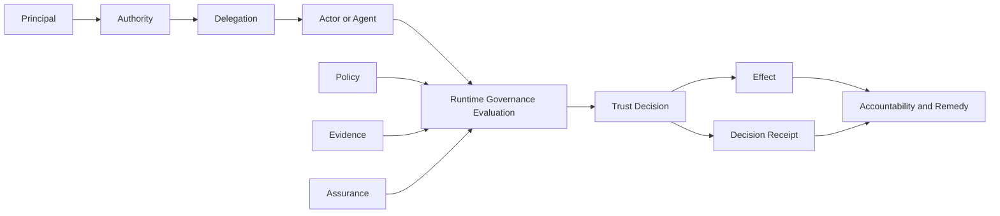
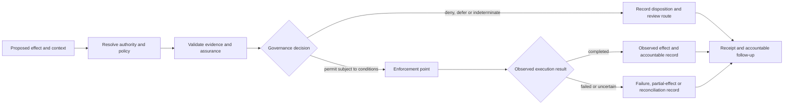

# Architecture Overview



GAAM is an effect-centred governance metamodel. It models how authority, policy, evidence and assurance combine to determine whether a proposed effect may occur and who remains accountable for the result.

## Architectural layers

### Institutional layer

Defines governance authority, applicable context, legal or contractual bases, decision rights, policy ownership, oversight and redress.

### Authority layer

Represents roles, permissions, prohibitions, obligations, constraints and delegation paths. Authority is always bounded and has a source.

### Evidence and assurance layer

Represents claims, evidence, verification, assessment, assurance conclusions, freshness and provenance.

### Decision layer

Evaluates a proposed effect against applicable authority, policy, evidence, context and risk. The result may permit, deny, restrict, suspend or route the effect for review.

### Accountability layer

Preserves decision receipts, governance events, affected-party rights, appeals, remedies and responsibility chains.

## Core flow

## How the model works as a complete decision

The five layers are *responsibility boundaries*, not a required five-service deployment. A single service may implement several responsibilities; separate organisations may retain independent authority even when components are colocated. GAAM describes the governance facts and invariants the deployment must preserve, not an obligatory policy engine or transport.

Consider a service operator allowing an employee-controlled software agent to request a change to a governed record. The presence of a valid agent identity, or of an API token with write capability, is not enough to establish authority to make that particular change.

1. **Establish institutional context.** Identify the governing instrument, its approving authority, applicable jurisdiction or contractual scope, affected parties and applicable review route. A correctly encoded instrument is not by itself proof of legal legitimacy; the relevant institution remains responsible for that determination.
2. **Establish operative authority.** Determine who may authorize the proposed effect, the source and scope of that power, whether it was delegated, and whether any parent grant has expired, been suspended or revoked. A delegation chain cannot amplify a parent grant merely because every link is syntactically valid.
3. **Establish reliance conditions.** Resolve the required claims, evidentiary provenance, status, freshness, applicable assurance assertions and unresolved conflicts. Validating a signature or schema does not establish that evidence is sufficient for this transaction.
4. **Make a contextual decision.** Evaluate the proposed *effect*, not just the requested API operation, against policy precedence, authority, purpose, constraints and risk. The outcome may permit, prohibit, restrict or require human review. Unavailable or indeterminate required authority is not permission.
5. **Enforce and observe separately.** An authorization decision is not proof of enforcement; successful enforcement is not proof that an external effect completed. Record the intended disposition, enforcement attempt, resulting state where observable, and partial or uncertain outcomes without substituting a decision receipt for an execution receipt.
6. **Preserve accountable continuation.** Link the decision to sufficient retained evidence, accountable parties and the paths for suspension, notice, challenge, review and remedy. Subsequent revocation may prevent future effects without retroactively undoing a completed external effect; compensation or correction may be required.

This sequence is an explanatory decomposition, not a new normative state machine. Specific transitions, outcome vocabularies and required artifacts are governed by the [Candidate Specification](../specification/governance-authority-assurance-metamodel.md), selected [profiles](../profiles/) and applicable [schemas](../schemas/). The [Basic Governed Decision walkthrough](../examples/basic-governed-decision/) maps these responsibilities to example artifacts.

### Three claims that must not be collapsed

- **Representation:** GAAM can express an authority source, applicability conditions and accountability chain. It cannot create the underlying authority or make a disputed institution legitimate.
- **Structural and behavioural validation:** a valid package or passed reference vector shows conformity with the checks performed, not lawful or substantively fair action, independent assurance or successful enforcement in a production deployment.
- **Trust determination:** an individual relying party or governance authority remains responsible for contextual recognition and reliance. A graph path, registry listing, credential or assurance label cannot automatically supply that decision.

### Decision, enforcement and effect

A decision receipt establishes the recorded decision and its grounds within its claimed scope. The implementation must not treat it as evidence that the enforcement point acted or that the intended effect occurred unless separately supported. For detailed engineering stages, see the [Implementation Guide](implementation-guide.md).

## Boundary rule

GAAM defines governance semantics, not protocol mechanics. Implementations may use different identity, credential, registry, policy, graph and agent protocols while remaining conformant, provided they preserve the required semantics and evidence.
