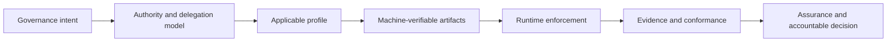

# Guided Learning Paths

GAAM is a concept-to-conformance specification. Readers should first understand the semantic model, then select a profile, implement machine-verifiable artifacts and finally produce evidence against normative requirements. Choose the route aligned to your authority and review role.

## Route 1: policy owner or governance designer

1. [Design principles](design-principles.md)
2. [Architecture overview](architecture-overview.md)
3. [Lifecycle model](lifecycle-model.md)
4. [Architecture diagrams](../diagrams/architecture-diagrams.md)
5. [Basic Governed Decision walkthrough](../examples/basic-governed-decision/walkthrough.md)
6. [Implementation patterns](../examples/index.md)

**Completion test:** you can identify the source of authority, delegation scope, enforcement and revocation mechanisms, evidence obligations and accountable assurance decision.

## Route 2: architect, profile author or implementer

1. [Normative specification](../specification/index.md)
2. [Foundation profile](../profiles/foundation-profile.md)
3. [Implementation guide](implementation-guide.md)
4. [Basic Governed Decision walkthrough](../examples/basic-governed-decision/walkthrough.md)
5. [Canonical schemas](../schemas/index.md)
6. [Controlled vocabularies](../vocabularies/index.md)
7. [Conformance and assurance](../conformance/index.md)

**Completion test:** each implemented governance claim maps to a normative requirement, canonical structure, enforcement behaviour and testable evidence item.

## Route 3: reviewer, auditor or assurance body

1. [Reviewer guide](reviewer-guide.md)
2. [Normative requirements index](../matrices/normative-requirements-index.md)
3. [Requirement-test coverage](../matrices/requirement-test-coverage.md)
4. [Threat and misuse-case model](../threat-model/README.md)
5. [Threat-control-test matrix](../matrices/threat-control-test-matrix.md)
6. [Conformance matrix](../matrices/conformance-matrix.md)

**Completion test:** the review can reproduce the applicable requirement set, inspect test coverage, locate evidence, identify exceptions and record an accountable disposition.

## Apply each role to one bounded gateway decision

The [Delegated Agent Purchasing gateway exercise](../examples/delegated-agent-purchase/adopter-gateway-exercise.md) is a **repository-controlled, informative** common case for these three audiences. It evaluates a delegated agent's request to make a consequential purchase. It is **not** independent implementation evidence, a production gateway, proof of source authenticity, a completed effect, or comprehensive profile conformance.

| Reader | Use the existing exercise to answer | Confirm before treating the route as complete |
| --- | --- | --- |
| Governance designer | Who is the originating principal, acting agent, governing authority, policy owner and accountable party? Which effect is in scope, and who decides disputes or remedies? | Trace the ten-element table to applicable GAAM requirements; distinguish a named authority source from independently established authority, and identify unresolved policy precedence and affected-party controls. |
| Implementer | Can published commands reproduce the request, delegated-scope comparison, time/status checks, negative and indeterminate results, and schema-valid decision receipt? | Run `python examples/delegated-agent-purchase/adopter_gateway.py < examples/delegated-agent-purchase/adopter-gateway-case.json` and `python -m pytest tests/test_adopter_gateway.py -q`; verify `effectExecuted: false`. The local scope comparator and observation conventions are **not** GAAM-wide normative semantics. |
| Reviewer | Which ten elements are demonstrated, partially demonstrated, or unverified, and what evidence would falsify the remaining claims? | Inspect the [normative requirements index](../matrices/normative-requirements-index.md), the exercise's F-102-A–E findings and the [implementation-report evidence boundary](../implementation-reports/README.md). A digest or synthetic PASS is not source authenticity, E2 evidence or cross-implementation interoperability. |

**Limits of this reader exercise:** these paths can be followed using public repository files, but no independent first-time reader study has been performed. External actor/source verification, policy authority, multi-source conflicts, operational enforcement and durable attributable evidence remain outside the demonstration. Report a missing or ambiguous normative expression as a finding under GAAM change control; do not promote the scenario's informative OAuth/MCP references or experimental schemas into mandatory rules.

## Bounded reader-path audit, not an external usability study

The repository-controlled review traverses three published routes: `README.md` → `docs/start-here.md` → `docs/guided-learning.md` and the role-specific links. The [ten-element gateway disposition](../examples/delegated-agent-purchase/adopter-gateway-exercise.md#normative-source-and-evidence-disposition-issue-102) is the shared decision boundary.

| Reader | Published answer that can be checked | Residual limitation |
| --- | --- | --- |
| Governance designer | The [architecture overview](architecture-overview.md) separates originating institutional authority, grants/delegation, contextual decisions, actual enforcement and remedy. The gateway maps principal, agent, effects and accountabilities to requirements. | Actual source acceptance, legal competence, policy precedence and remedy operation require external facts; a reader study has not been conducted. |
| Implementer | [Quickstart](implementer-quickstart.md), [starter](../conformance-kit/README.md), [canonical schemas](../schemas/index.md) and gateway CLI provide a reproducible E1 decision with a bounded negative matrix. | Synthetic input labels are not authenticated, and the local scope comparator is informative. The E1 dossier is not an independent implementation report. |
| Assurance reviewer | [Reviewer guide](reviewer-guide.md), [normative requirements index](../matrices/normative-requirements-index.md), [implementation reports](../implementation-reports/README.md) and the gateway evidence table distinguish required claims, performed checks, provenance and external acceptance. | Receipt digest and check PASS do not establish actor provenance, performed effects, E2 independence or E3 interoperability. |

**Audit disposition:** role destinations are discoverable through the existing learning-path manifest and Pages validation; no extra prerequisite, parallel document taxonomy or mandatory gateway framework is needed. The named source, bounded result and non-claim can be located by each role. These are source/contract findings, **not measured comprehension by an unfamiliar participant**, nor a quantitative onboarding study. No measured setup failures, maintainer interventions or elapsed time to first meaningful result are asserted.

## Normative reading rule

Informative guidance explains how to apply GAAM but does not replace the normative specification, profiles, schemas or conformance requirements. Record the exact version and profile used whenever making a conformance or assurance claim.

[Continue to the documentation architecture →](documentation-architecture.md)

## Foundational-to-ecosystem pattern path

1. [Basic Governed Decision](../examples/basic-governed-decision/)
2. [Authority Lifecycle and Revocation](../examples/authority-lifecycle-and-revocation/)
3. [Independent Assurance Assessment](../examples/independent-assurance-assessment/)
4. [Notice, Challenge, and Remedy](../examples/notice-challenge-and-remedy/)
5. [Machine-Actionable Governance Package](../examples/machine-actionable-governance-package/)
6. [Delegated Agent Purchasing](../examples/delegated-agent-purchase/)
7. [Cross-Registry Recognition](../examples/cross-registry-recognition/)
8. [High-Impact Multi-Agent Service](../examples/high-impact-multi-agent-service/)
9. [Governed Ecosystem Operations](../examples/governed-ecosystem-operations/)
