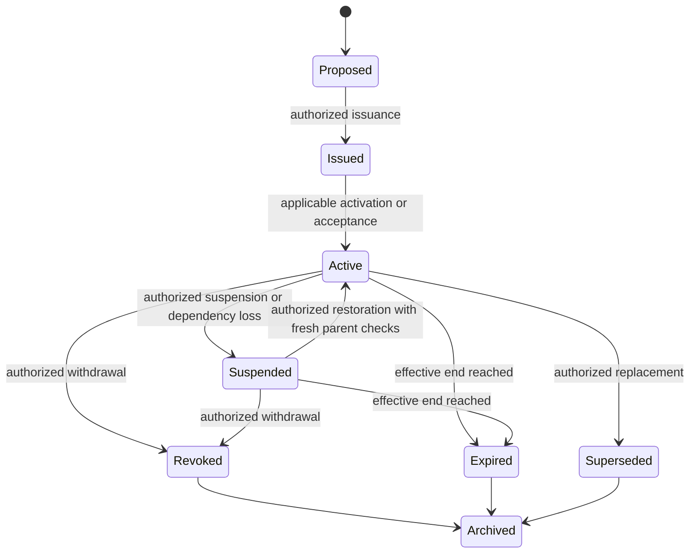
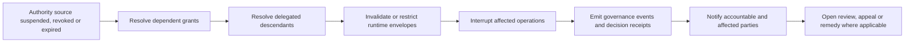

# Governance Artifact Lifecycle Model

GAAM uses explicit state machines for authority, delegation, role assignment, agent identity, evidence, assurance, recognition, packages, decisions, receipts, incidents, appeals and remedies.

## Common states

`draft → proposed → issued → accepted → active → restricted | suspended | revoked | expired | superseded | terminated → archived`

`contested` and `remediated` apply where review and remedy are available. Not every artifact uses every state.

## Authority and delegation: illustrative state-specific transitions

The common-state list is a vocabulary of possible states, **not** an assertion that every object follows every transition. Authority and delegation are separate governed artifacts whose activation and continuity depend on their own source, effective time, approval and parent relationships.

These transitions illustrate governance conditions, not an exhaustive normative lifecycle. **Revoked, expired and superseded are not reusable active grants.** Recovery requires a newly established or otherwise independently valid authority source; relabelling a revoked record as active does not restore it. Restoration from suspension requires an authorised decision, valid parent chain and current evidence; it is not automatic. The exact applicable transitions and notices depend on the specification, controlling documents and selected profiles.

| Transition question | Required interpretation |
| --- | --- |
| Who can change the state? | An explicitly recognised transition authority, not merely the actor operating the API. |
| When does the transition take effect? | The event's effective time and governing context must be resolved. |
| What happens to descendants? | Re-evaluate their scope and status; independently granted authority must remain distinguishable from dependent authority. |
| What if state is unavailable or conflicting? | Do not treat it as active by default; make the indeterminate decision and escalation observable. |
| What about already completed effects? | Blocking future authority does not automatically undo an external action; review, correction or remedy may be required. |

## Transition control

Every transition identifies transition authority, preconditions, evidence, effective time, emitted governance event and effects on dependent artifacts. Invalid or unauthorised transitions fail closed.

## Propagation

Parent authority suspension, revocation and expiry propagate according to the delegation record. Descendant authority cannot remain operative beyond the effective parent authority unless an independently valid authority source is recorded.

## Revocation and dependency propagation

Propagation is evaluated from the authoritative dependency graph. Implementations must preserve the event, effective time, initiating authority and affected descendants as auditable evidence.
