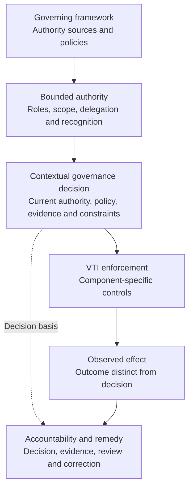

# DTG/VTI Governance Expressivity Assessment



> **Disposition: adequate with domain-specific specialization, in the selected requirement sample.** This is an informative expressivity assessment against a VTI Working Draft, not conformance testing, deployment assurance, certification, or a decision of the ToIP working group.

## Research question and assessed sources

[Issue #122](https://github.com/qbf-consulting/governance-authority-assurance-metamodel/issues/122) asks whether GAAM can express the governance requirements of DTG/VTI without importing DTG/VTI technical primitives into the normative GAAM core.

- **GAAM semantic baseline:** [v0.9.0 Candidate normative edition](../specification/governance-authority-assurance-metamodel.md), inspected on repository main at [`a1db5f905dd6`](https://github.com/qbf-consulting/governance-authority-assurance-metamodel/tree/a1db5f905dd60f5ea0c17df84171d6da41947d8a). The later v0.9.5 maintenance distribution does not introduce a normative v0.9.5 specification edition; experimental extensions were excluded.
- **VTI source:** [ToIP VTI Working Draft at `416899c37f8a`](https://github.com/trustoverip/dtgwg-vti-spec/tree/416899c37f8a1b88a47dbeab378e227c6d4742e1/spec) and [structure/decision record](https://github.com/trustoverip/dtgwg-vti-spec/blob/416899c37f8a1b88a47dbeab378e227c6d4742e1/STRUCTURE.md), inspected 2026-11-13. Its VTN target, Appendix C decisions, and test-suite governance are not yet settled. Requirement wording and ownership can change before working-group approval.
- **Methodological distinction:** This exercise tests GAAM **expressibility**, not the GAAM ecosystem [readiness assessments](ecosystem-assessment-method.md). It deliberately does not translate mappings into readiness scores, assurance levels, or claims of GAAM/VTI conformance.

**Selection rule:** purposively sample VTI requirements that materially affect authority source/scope, delegated agency, role and membership lifecycle, community governance, collective decisions, registry or network recognition, evidentiary reliance, consequential effects, revocation, accountability, and conformance-authority boundaries. Exclude syntax, identifiers, cryptographic algorithms, transport mechanics, and ballot privacy cryptography as technical-only matters. 39 requirement statements were mapped (30 directly expressible; 9 through VTI-specific specialization). This is not exhaustive coverage of VTI's normative requirement population.

## Modeled governance domain

| Governance component | GAAM model | Critical non-implication |
| --- | --- | --- |
| Principal and VTA | Principal; source-bounded context authority; VTA/operator roles; scoped client delegation | Custody of a key or tree does not grant VTC governance rights. |
| Trust contexts | Governance context and scope constraints; VTI-specific segment-ancestry rule | Technical context ancestry does not establish institutional legitimacy. |
| VTC | Community framework; membership states; role powers; source policy; collective governance procedures | A valid vote or community policy does not by itself change ACL grants. |
| Client and agent | Delegate; capabilities; delegation chain; redelegation conditions; effective period and event lineage | Callable capability, authentication, or user key is not sufficient permission. |
| VTN | Network governance owner; attributable directed listing; acknowledgment and repudiation state | Listing need not imply consent, membership, recognition, or reciprocal obligation. |
| Recognizing VTC | Local reliance policy; explicit foreign-role mapping; scoped contextual recognition | A recognizes B and B recognizes C does not yield A recognizes C. |
| Registry and credential | Issuer source, typed assertion, status/freshness, relying-party determination | Valid assertion or registry entry is not operative authority on its own. |
| Operations and remedy | Proposed effect, contextual decision, enforcement, actual outcome, recorded challenge and remedy | Successful protocol execution cannot prove correct authorization or completed effect. |

## Conceptual governance flow

The diagram separates the governance questions GAAM can express from the infrastructure-specific controls VTI defines. It is an **informative responsibility and evidence flow**, not an additional VTI protocol, required service topology, or state machine.

**How to read it.** GAAM models the authority basis, the conditions for a decision, and the attribution of results and remedies. VTI defines the mechanisms that may enforce these decisions within its component and composition requirements. A verified credential or registry entry is evidence, not itself permission; a permitted decision is not proof that the effect occurred. Delegation, recognition, withdrawal and challenge are governed relationships or events, not implied additional protocol steps. Accountability can be engaged by a decision or refusal even when no effect occurs.

**Authority path.** A governing institution or community framework sources authority → a principal or authorized community role holds scoped decision rights → a VTA or VTC expresses technical grants within its own decision boundary → an authorized delegate performs a requested operation → the relevant decision owner applies current policy, status, evidence and constraints → the enforcement result and the observed effect are recorded separately → accountable actors preserve challenge and correction paths. This is a semantic responsibility decomposition, **not** an asserted VTI deployment topology or a new protocol.

**Collective governance.** VTI voting expressly does not supply a new authority model; elections decide only within their manifest and subsequent changes still use the authorization model. GAAM's framework authority, roles, collective decision formation, constraints and consequential-effect constructs can represent the institutional condition under which a result becomes binding. Exact eligibility, quorum, secrecy, tally and election protocol rules remain community/VTI specializations. Absence of a GAAM-specific `BallotBox` class is not a model deficiency.

**Asymmetric network relationships.** A VTN may make a unilateral listing while a listed party does not acknowledge or repudiates it. GAAM can represent an attributed graph assertion and a separately contested status, under a particular governance context. The VTN-specific acknowledgement field is a specialization; it must not be collapsed into reciprocal recognition or consent. The VTN's *target classification* is still subject to upstream working-group resolution.

**Temporal semantics.** Authority revocation, evidentiary currency, historical verification, completed external effects and correction/remedy are different facts. GAAM lifecycle, events, decision and effect concepts can express these distinctions. A live implementation must enforce the applicable VTI rules; model expressivity alone proves no enforcement.

## Requirement-to-concept traceability

Classification: **direct** means existing GAAM constructs preserve the governance meaning; **specialization** means VTI-specific domain rules are necessary without modifying GAAM's core. **ambiguous**, **not-expressible**, **outside-scope** and **indeterminate** remain available classes for future assessments. No unsupported absence claims are inferred from this sample. The [structured mapping](dtg-vti-gaam-requirements.json) records the same conclusions.

| VTI requirement | GAAM normative identifiers | Class | Modeling interpretation |
| --- | --- | --- | --- |
| [VTI-CTX-001](https://github.com/trustoverip/dtgwg-vti-spec/blob/416899c37f8a1b88a47dbeab378e227c6d4742e1/spec/03-trust-contexts.md) | GAAM-CTX-001, GAAM-AUTH-002 | direct | Resource-to-context affiliation supplies a governance-context input, not permission. |
| [VTI-CTX-017](https://github.com/trustoverip/dtgwg-vti-spec/blob/416899c37f8a1b88a47dbeab378e227c6d4742e1/spec/03-trust-contexts.md) | GAAM-CTX-001, GAAM-AUTH-002, GAAM-POL-001 | specialization | VTI segment-aware ancestry is a domain-specific authority scope rule; not generic GAAM inheritance. |
| [VTI-CTX-020](https://github.com/trustoverip/dtgwg-vti-spec/blob/416899c37f8a1b88a47dbeab378e227c6d4742e1/spec/03-trust-contexts.md) | GAAM-AUTH-002, GAAM-EFF-002 | direct | Context creation is a governed effect requiring current scoped authority. |
| [VTI-ACL-001](https://github.com/trustoverip/dtgwg-vti-spec/blob/416899c37f8a1b88a47dbeab378e227c6d4742e1/spec/03a-access-control.md) | GAAM-ART-001, GAAM-AUTH-003 | direct | An access entry can encode bounded authority; technical entry existence alone does not prove legitimate origin. |
| [VTI-ACL-010](https://github.com/trustoverip/dtgwg-vti-spec/blob/416899c37f8a1b88a47dbeab378e227c6d4742e1/spec/03a-access-control.md) | GAAM-AUTH-002, GAAM-CORE-003 | direct | Roles impose authority ceilings rather than unconditional grants. |
| [VTI-ACL-030](https://github.com/trustoverip/dtgwg-vti-spec/blob/416899c37f8a1b88a47dbeab378e227c6d4742e1/spec/03a-access-control.md) | GAAM-AUTH-004, GAAM-ART-005 | direct | Effective rights derive from role, capability, scope, policy and live authority intersection. |
| [VTI-ACL-070](https://github.com/trustoverip/dtgwg-vti-spec/blob/416899c37f8a1b88a47dbeab378e227c6d4742e1/spec/03a-access-control.md) | GAAM-DEL-001, GAAM-ART-004 | direct | Delegation is a sourced, scoped and terminable grant, not mere client registration. |
| [VTI-ACL-071](https://github.com/trustoverip/dtgwg-vti-spec/blob/416899c37f8a1b88a47dbeab378e227c6d4742e1/spec/03a-access-control.md) | GAAM-DEL-003, GAAM-ART-005 | direct | Child authority cannot amplify the valid parent authority. |
| [VTI-ACL-073](https://github.com/trustoverip/dtgwg-vti-spec/blob/416899c37f8a1b88a47dbeab378e227c6d4742e1/spec/03a-access-control.md) | GAAM-DEL-002, GAAM-DEL-010 | direct | Redelegation needs explicit permission and validated ancestry. |
| [VTI-ACL-080](https://github.com/trustoverip/dtgwg-vti-spec/blob/416899c37f8a1b88a47dbeab378e227c6d4742e1/spec/03a-access-control.md) | GAAM-LIFE-004, GAAM-RUN-003 | specialization | VTI next-decision withdrawal is a lifecycle enforcement specialization; it does not undo past effects. |
| [VTI-ACL-090](https://github.com/trustoverip/dtgwg-vti-spec/blob/416899c37f8a1b88a47dbeab378e227c6d4742e1/spec/03a-access-control.md) | GAAM-GF-006, GAAM-AUTH-001 | specialization | VTA custody and context authority are assigned technical roles, not institutional legitimacy or VTC membership powers. |
| [VTI-VTC-012](https://github.com/trustoverip/dtgwg-vti-spec/blob/416899c37f8a1b88a47dbeab378e227c6d4742e1/spec/11-vtc.md) | GAAM-GF-006, GAAM-CORE-003 | specialization | VTC decision powers and their separation from VTA decisions are specific authority-role assignments. |
| [VTI-VTC-022](https://github.com/trustoverip/dtgwg-vti-spec/blob/416899c37f8a1b88a47dbeab378e227c6d4742e1/spec/11-vtc.md) | GAAM-POL-002, GAAM-AUTH-001 | direct | Community policy constrains rather than independently generates authority. |
| [VTI-MEM-010](https://github.com/trustoverip/dtgwg-vti-spec/blob/416899c37f8a1b88a47dbeab378e227c6d4742e1/spec/12-vtc-lifecycle.md) | GAAM-AUTH-002, GAAM-LIFE-002 | direct | Admission is an authorized membership transition; joining a protocol is insufficient. |
| [VTI-MEM-031](https://github.com/trustoverip/dtgwg-vti-spec/blob/416899c37f8a1b88a47dbeab378e227c6d4742e1/spec/12-vtc-lifecycle.md) | GAAM-LIFE-004, GAAM-PRIV-001, GAAM-RED-007 | specialization | Departure and erasure are distinct effects with community privacy and evidence-retention constraints. |
| [VTI-VOT-010](https://github.com/trustoverip/dtgwg-vti-spec/blob/416899c37f8a1b88a47dbeab378e227c6d4742e1/spec/12b-vtc-voting.md) | GAAM-GF-007, GAAM-POL-003 | specialization | Election manifest instantiates community collective-decision procedure and applicable policy, not a generic metamodel ballot. |
| [VTI-VOT-021](https://github.com/trustoverip/dtgwg-vti-spec/blob/416899c37f8a1b88a47dbeab378e227c6d4742e1/spec/12b-vtc-voting.md) | GAAM-CORE-003, GAAM-EVID-001 | direct | Eligibility and evidence for a ticket confer no general community authority. |
| [VTI-VOT-071](https://github.com/trustoverip/dtgwg-vti-spec/blob/416899c37f8a1b88a47dbeab378e227c6d4742e1/spec/12b-vtc-voting.md) | GAAM-ASSUR-001, GAAM-DEC-001 | direct | Certification is attributable and evidence-based, not itself an unlimited grant. |
| [VTI-VOT-081](https://github.com/trustoverip/dtgwg-vti-spec/blob/416899c37f8a1b88a47dbeab378e227c6d4742e1/spec/12b-vtc-voting.md) | GAAM-GF-007, GAAM-POL-002, GAAM-EFF-002 | specialization | Binding collective procedure is an authority condition, separate from execution and technical tally. |
| [VTI-VTN-002](https://github.com/trustoverip/dtgwg-vti-spec/blob/416899c37f8a1b88a47dbeab378e227c6d4742e1/spec/11a-vtn.md) | GAAM-CORE-002, GAAM-GF-006 | direct | Network owner and public policy establish attributable governance role, not universal recognition. |
| [VTI-VTN-010](https://github.com/trustoverip/dtgwg-vti-spec/blob/416899c37f8a1b88a47dbeab378e227c6d4742e1/spec/11a-vtn.md) | GAAM-GRAPH-001, GAAM-REL-001 | specialization | Unsolicited listing is a unilateral attributed assertion, not consent or membership. |
| [VTI-VTN-012](https://github.com/trustoverip/dtgwg-vti-spec/blob/416899c37f8a1b88a47dbeab378e227c6d4742e1/spec/11a-vtn.md) | GAAM-GRAPH-008, GAAM-REG-004, GAAM-RED-004 | specialization | Repudiation is a contestation state linked to the original assertion, not automatic historical erasure. |
| [VTI-VTN-020](https://github.com/trustoverip/dtgwg-vti-spec/blob/416899c37f8a1b88a47dbeab378e227c6d4742e1/spec/11a-vtn.md) | GAAM-DEC-002, GAAM-REG-001 | direct | VTN listing cannot itself establish operative standing. |
| [VTI-VTN-052](https://github.com/trustoverip/dtgwg-vti-spec/blob/416899c37f8a1b88a47dbeab378e227c6d4742e1/spec/11a-vtn.md) | GAAM-REL-002, GAAM-GRAPH-002 | direct | Endorsement is scoped evidence and not an authority delegation. |
| [VTI-REG-002](https://github.com/trustoverip/dtgwg-vti-spec/blob/416899c37f8a1b88a47dbeab378e227c6d4742e1/spec/13-registries.md) | GAAM-REG-003, GAAM-REL-001 | direct | Registry statement is bound to its governing framework and declared semantics. |
| [VTI-REG-003](https://github.com/trustoverip/dtgwg-vti-spec/blob/416899c37f8a1b88a47dbeab378e227c6d4742e1/spec/13-registries.md) | GAAM-AUTH-003, GAAM-REG-001 | direct | Registry statement cannot grant more than the framework explicitly asserts. |
| [VTI-REG-011](https://github.com/trustoverip/dtgwg-vti-spec/blob/416899c37f8a1b88a47dbeab378e227c6d4742e1/spec/13-registries.md) | GAAM-EVID-003, GAAM-RUN-003 | direct | Time-bounded registry evidence is not permanent current authority. |
| [VTI-REG-023](https://github.com/trustoverip/dtgwg-vti-spec/blob/416899c37f8a1b88a47dbeab378e227c6d4742e1/spec/13-registries.md) | GAAM-CTX-002, GAAM-REG-006 | direct | Foreign role mapping is explicit local policy subject to local standing ceilings. |
| [VTI-REG-024](https://github.com/trustoverip/dtgwg-vti-spec/blob/416899c37f8a1b88a47dbeab378e227c6d4742e1/spec/13-registries.md) | GAAM-GRAPH-006, GAAM-GRAPH-007 | direct | Recognition is directional and non-transitive absent explicit local decision. |
| [VTI-CMP-020](https://github.com/trustoverip/dtgwg-vti-spec/blob/416899c37f8a1b88a47dbeab378e227c6d4742e1/spec/14-composition.md) | GAAM-EFF-002, GAAM-OUT-003 | direct | Protocol success is separate from authorized effect and observed completion. |
| [VTI-CMP-030](https://github.com/trustoverip/dtgwg-vti-spec/blob/416899c37f8a1b88a47dbeab378e227c6d4742e1/spec/14-composition.md) | GAAM-ASSUR-001, GAAM-DEC-002 | direct | Proof verification is decision evidence, not the decision. |
| [VTI-CMP-032](https://github.com/trustoverip/dtgwg-vti-spec/blob/416899c37f8a1b88a47dbeab378e227c6d4742e1/spec/14-composition.md) | GAAM-RUN-003, GAAM-EVID-003 | direct | Current operative authority has temporal and freshness conditions. |
| [VTI-CMP-050](https://github.com/trustoverip/dtgwg-vti-spec/blob/416899c37f8a1b88a47dbeab378e227c6d4742e1/spec/14-composition.md) | GAAM-DEL-003, GAAM-DEL-013 | direct | Combined components cannot amplify effective authority. |
| [VTI-CMP-080](https://github.com/trustoverip/dtgwg-vti-spec/blob/416899c37f8a1b88a47dbeab378e227c6d4742e1/spec/14-composition.md) | GAAM-RUN-002, GAAM-EVID-004 | direct | Indeterminate evidence must not become fictitious success. |
| [VTI-CMP-111](https://github.com/trustoverip/dtgwg-vti-spec/blob/416899c37f8a1b88a47dbeab378e227c6d4742e1/spec/14-composition.md) | GAAM-AGT-019, GAAM-EFF-002 | direct | Human approval is action-bound; delegated client cannot substitute unrelated approval. |
| [VTI-AUD-002](https://github.com/trustoverip/dtgwg-vti-spec/blob/416899c37f8a1b88a47dbeab378e227c6d4742e1/spec/03c-audit.md) | GAAM-EVT-002, GAAM-OUT-003 | direct | Action attribution and evidence allow decision reconstruction; logs are not legitimacy. |
| [VTI-OPR-020](https://github.com/trustoverip/dtgwg-vti-spec/blob/416899c37f8a1b88a47dbeab378e227c6d4742e1/spec/15-operational.md) | GAAM-RUN-009, GAAM-LIFE-004 | direct | Emergency withdrawal is a governed lifecycle effect, distinct from successful containment. |
| [VTI-OPR-032](https://github.com/trustoverip/dtgwg-vti-spec/blob/416899c37f8a1b88a47dbeab378e227c6d4742e1/spec/15-operational.md) | GAAM-EVT-002, GAAM-LIFE-005 | direct | Historical evidence reconstructs operative past state without substituting present state. |
| [VTI-CNF-020](https://github.com/trustoverip/dtgwg-vti-spec/blob/416899c37f8a1b88a47dbeab378e227c6d4742e1/spec/95-conformance.md) | GAAM-CONF-001, GAAM-ASSUR-002 | direct | Assessor authority is evidence scope only; cannot supersede VTI normative authority. |

## Boundary tests and competing explanations

[Six semantic counterexample cases](dtg-vti-gaam-boundary-cases.md) test: authenticated but unauthorized client; nested scope amplification; collective vote mistaken for grant; transitive recognition; repudiated unsolicited listing; revocation mistaken for completed-effect rollback. These are **reasoned semantic tests against source text**, not executable validation of a deployment.

No sampled obligation was unrepresentable using existing GAAM entities, relations, normative constraints, governance events, and legitimate domain specialization. That outcome does **not** prove the metamodel is universally complete: a missed governance clause, a future VTI revision, conflicting legal rule, or independent modeling counterexample could refute it.

## Decision, evidence and next steps

**Disposition: adequate with specialization.** The evidence supports an informative domain-model example and traceable mapping, not a GAAM core amendment or a new normative VTI profile. No GAAM or VTI conformance, operational enforcement, independent legal legitimacy, or WG adoption claim is made.

The VTI Working Draft already includes explicit authority and composition safeguards. Do not misclassify these as VTI gaps or propose redundant enforcement. The most useful next challenge, only if demanded by later evidence, is modeling a complex collective decision or conflicting multi-framework recognition rule under a pinned source version and showing a concrete contradiction that cannot be resolved through domain specialization.

**Release decision:** commit-only/documentation research; no changed normative semantics, schema, profiles, tests or compatibility baseline, so no GAAM release is warranted.
