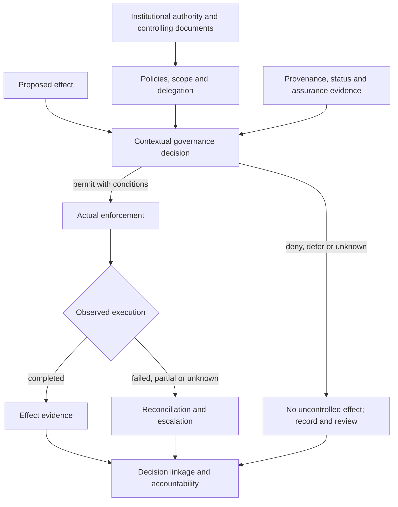

# Pilot Design and Boundaries

A GAAM pilot starts with a **governed effect**, not with a software stack. Choose a concrete action whose legitimacy depends on context, authority, evidence, risk or delegation. Examples include an employee-authorised record change, an agent's bounded purchasing action, or recognition of a cross-registry claim. Choose one effect and one clearly defined failure case for the first pilot.

## Responsibility and authority boundaries

| Role | Owns or demonstrates | Cannot assume |
| --- | --- | --- |
| Sponsor / institutional authority | Approves scope, authority sources, affected-party and redress arrangements | API or repository ownership is sufficient institutional authority |
| Governance / policy owner | Applicable policies, precedence, exceptions, restrictions and lifecycle authority | The schema will resolve conflicting legal duties |
| Implementer / operator | Runtime interfaces, control enforcement, state propagation, evidence and failure handling | Possession of credentials proves authority |
| Evidence owner / assessor | Integrity, provenance, independence disclosures, verification and limitations | Self-assessed evidence is independent |
| Affected-party / reviewer representative | Accessibility of notice, challenge, oversight and practical remedy | An error log alone constitutes a remedy |

A person may cover several roles in a small pilot, but conflicts of interest and the source of approval must be visible. An external pilot must identify the real governing institution; GAAM maintainers cannot approve its delegated authority.

## Architecture and control points

This is a logical division of responsibilities, not a mandatory service topology. An operator may implement several components together. The boundary between **decision** and **executed effect** must nevertheless remain observable.

## Safety and production boundary

- Use synthetic or otherwise appropriately approved test data. Do not operate on live accounts, irreversible payments or production privileges by default.
- Scope each pilot authority to test resources and environments, with independent interruption and rollback/compensation mechanisms where applicable.
- Define expiry, revocation, status unavailability, stale evidence, delayed propagation, retry/replay, and partial-effect handling before using an agent or external tool.
- Retain minimal, verifiable evidence without unnecessarily disclosing affected-party data.
- Do not conflate passing schema/vector tests, pilot gate completion, and independent assessment.

## Minimum implemented surfaces

The pilot declares (i) authoritative source and accountable actor, (ii) applicability and scope, (iii) policy/evidence decision inputs, (iv) enforcement outcome, (v) decision and event records, and (vi) notice/review/remedy route. Consult the [implementation guide](../docs/implementation-guide.md), [lifecycle model](../docs/lifecycle-model.md), [canonical schemas](../schemas/index.md), and [implementation-report evidence guide](../implementation-reports/evidence-guide.md). No mandatory identifier method, blockchain, policy language, agent framework or transport is introduced here.
